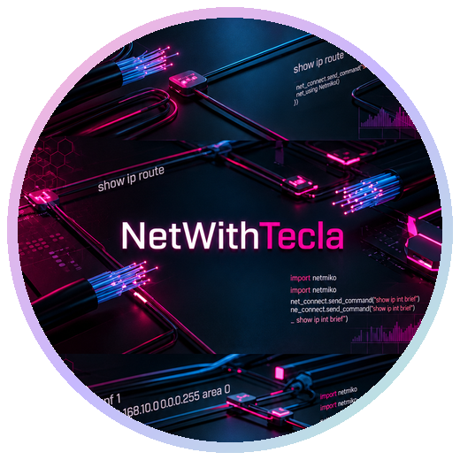

<h1>Tecla Wairimu Gicheha</h1>

<b>CCNA Certified Network Associate</b>

 

Networking &middot; Network Security &middot; IT Infrastructure

  

I build secure, well-documented networks &mdash; routing, switching, firewall
policy and encrypted WAN links &mdash; and automate the repetitive parts with Python.

## About

CCNA-certified Network Associate based in Kenya. I configure and maintain routed
and switched networks, implement security policy, and write Python automation
that removes manual configuration errors. I like clean documentation and labs
that are honest about what works.

- **Focus:** enterprise routing, network security and infrastructure support.
- **Currently:** hardening enterprise-style labs and documenting secure designs.
- **Education:** BSc Information Technology, Multimedia University of Kenya (2022 &ndash; 2026).

---

## Toolkit

**Networking** &nbsp; `TCP/IP` `IPv4 subnetting` `VLANs` `Trunking` `Inter-VLAN routing` `OSPF` `EIGRP`

**Network Security** &nbsp; `ACLs` `DMZ design` `IPsec VPN` `AAA` `RADIUS` `TACACS+` `Port security` `DHCP snooping` `DAI`

**Infrastructure & Tools** &nbsp; `Cisco Packet Tracer` `GNS3` `VMware Workstation` `Wireshark` `Ubuntu` `GitHub`

**Automation** &nbsp; `Python` `Netmiko` `Jinja2` `YAML templating` `SSH automation`

---

## Experience

### Network & IT Infrastructure Intern
**Amref Health Africa** &middot; Lang'ata, Kenya

- Configured and maintained core office networks across departmental branches.
- Reduced downtime through hardware health monitoring, port checks and fault resolution.
- Hardened endpoints with ACLs and compliance audits; supported hybrid meetings and webinars.

### Network & IT Infrastructure Intern
**Ministry of Trade and Industry** &middot; Telposta Towers, Kenya

- Reduced downtime by monitoring hardware health and resolving connectivity faults.
- Diagnosed physical and logical faults with Ping, Traceroute and NSLookup.

---

## Featured Project

A multi-site Packet Tracer lab with HQ, DMZ, ISP transit and a branch joined by
a site-to-site IPsec tunnel. It ships the annotated `.pkt`, eight extracted
configurations, topology exports and an honest review of what still needs work.

---

## Certifications & Education

| Certifications | Education |
| :--- | :--- |
| **CCNA v7** &mdash; Cisco Networking Academy (Jomo Kenyatta University) &middot; Active | **BSc Information Technology** &mdash; Multimedia University of Kenya &middot; 2022 &ndash; 2026 |
| **Network Security Certificate** &mdash; Cisco Networking Academy (African Advanced Level Telecommunications Institute) &middot; Active | |

---

## GitHub Stats

---

### Let's connect

  

Thanks for stopping by. Every packet tells a story &mdash; make sure yours is encrypted.

 

<a href="./Neon%20Cyberpunk%20Networking%20Wallpaper.png">Wallpaper</a>

